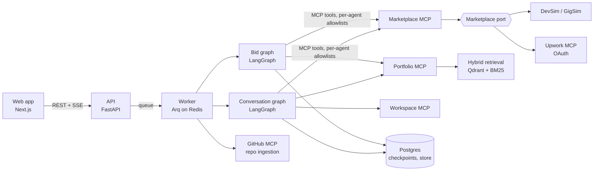

# GigBid — a multi-agent freelancer copilot

GigBid finds freelance jobs, decides which are worth a bid, prices them, and drafts proposals that
cite only work the freelancer has really done. It catches scams and planted instructions in job
posts, keeps the freelancer's own style, and never sends anything without a human approving it.
It runs on DevSim (a simulated marketplace) for development and on the official Upwork MCP server
for real use.

> **Demo:** the 30-second GIF goes here (`docs/images/demo.gif`).
> **Live:** the public deployment link goes here, with the reviewer login given in the submission.

AI-4016 assignment II. Everything measured here is on DevSim stand-in data, because the official
GigSim and its data were not provided; result files say so in their `data_source` field.

## What it does

- **Finds and triages jobs** from saved searches, on a schedule, in a background worker.
- **Analyses each job in parallel** — requirements, risk (scams, free-work requests, off-platform
  payment, planted instructions) and fit against the portfolio — then decides to skip, watch or bid.
- **Prices from evidence**: market rates, the client's budget, the freelancer's floor and the
  Connects cost.
- **Writes a proposal grounded in evidence**, verifies every claim against the portfolio, has a
  Critic review it (at most two revisions), and runs a Compliance Guard over the final text.
- **Stops for approval** with the draft, the evidence behind each claim, the risk report, the price
  rationale and a dry-run preview of what would be sent and what it costs. Approve, edit or reject.
- **Handles client replies** in a second graph: classifies intent, drafts a reply or interview
  slots, and stops for approval again.
- **Learns** a style memory from the freelancer's edits and an outcome memory of what won, only
  through explicit promotion rules.
- **Live Upwork mode**: OAuth sign-in, encrypted per-user tokens, and two separate approvals before
  anything is sent on Upwork.

## Architecture



- Both graphs, rendered from the code: [docs/GRAPHS.md](docs/GRAPHS.md).
- Why each agent exists, the stores and the trust boundaries: [docs/ARCHITECTURE.md](docs/ARCHITECTURE.md).
- Every MCP tool, with annotations and auth: [docs/TOOLS.md](docs/TOOLS.md).
- Decisions and their reasons: [docs/adr/](docs/adr/).

## Results

The table below is generated from `evals/results/` by `python -m evals.results_table`; do not
edit it by hand.

<!-- results:start -->
Data source: DevSim stand-in data, not GigSim. Deployed variant: `combo:decompose+hybrid+outcome`.

| Variant | Evidence Recall@5, whole job | Evidence Recall@5, per requirement | nDCG@10, per requirement | Unsupported claims per proposal | Judge score | Simulated reply rate | p95 latency (s) | Cost per proposal (USD) | Proposals measured |
|---|---|---|---|---|---|---|---|---|---|
| V0 | 0.093 | 0.4132 | 0.4636 | 0 | 3.8 | 0.4 | 137.26 | 0.004372 | 5 |
| Your best | 0.3074 | 0.5755 | 0.6303 | not measured | not measured | not measured | not measured | not measured | 0 |

Judge calibration, Cohen's kappa: -0.129.
<!-- results:end -->

- Retrieval variants, ablation and the hypothesis: [docs/RND_B_RETRIEVAL.md](docs/RND_B_RETRIEVAL.md).
- Tool granularity (R&D question A): [docs/RND_A_TOOL_GRANULARITY.md](docs/RND_A_TOOL_GRANULARITY.md).
- Multi-agent comparison (R&D question C): [docs/RND_C_ORCHESTRATION.md](docs/RND_C_ORCHESTRATION.md).
- Budgets and the optimisation that helped: `evals/results/budgets_devsim.json`.
- The change request and what it cost: [docs/CHANGE_REQUEST.md](docs/CHANGE_REQUEST.md).

### Multi-agent comparison

ReAct agent versus prebuilt supervisor versus the hand-built graph, on the same jobs. The table is
filled from `evals/results/rqc_comparison_devsim.json` when the run completes; see
[docs/RND_C_ORCHESTRATION.md](docs/RND_C_ORCHESTRATION.md) for the method.

### Public traces

- A skipped scam: *link to be added*
- An approved proposal: *link to be added*
- A Critic revision loop: *link to be added*

## Run it

Everything, with Docker (web, API, worker, the three MCP servers, DevSim, Postgres, Redis, Qdrant,
Ollama):

```bash
cp .env.example .env    # then fill in GROQ_API_KEY and the keys marked replace_me
make dev                # or: make demo, then open http://localhost:3000
```

Without Docker for the app (the stores still run in Docker): `make db`, `make seed`, `make ingest`,
then `uv run --locked --env-file .env python -m scripts.run_api`, `make worker`, and
`npm --prefix apps/web run dev`. Details, schedules and recovery: [docs/RUNBOOK.md](docs/RUNBOOK.md).
Public deployment: [docs/DEPLOYMENT.md](docs/DEPLOYMENT.md).

| Command | What it does |
|---|---|
| `make test` | Unit, contract and integration tests |
| `make lint` | Ruff, mypy (strict) and the repository guards |
| `make eval` | Retrieval, decision and outcome evaluations into `evals/results/` |
| `make e2e` | Playwright end-to-end tests |

## Safety

GigBid never submits a proposal, sends a message or spends Connects without explicit human
approval; on Upwork it needs two. Job posts and client messages are untrusted data: they are
delimited, scanned for planted instructions and never followed. Contact details, payment details
and guarantees are removed or blocked before anything leaves. OAuth tokens are encrypted per user,
logs and traces mask personal data, and every query is scoped to its user. GigBid uses official
APIs only: no scraping and no browser automation.

## Stack

Python 3.13 with uv; LangGraph `1.2.20`, LangChain `1.4.9`, the MCP Python SDK `1.30.0`,
FastAPI `0.162.2`, Arq `0.28.0`, Qdrant client `1.20.0`, fastembed `0.9.1`; Next.js `16.4.5`
with React `19.3.1`; Postgres 17, Redis 7, Qdrant `v1.20.0`. All versions are pinned in
`pyproject.toml`, `uv.lock` and `apps/web/package-lock.json`.

Models (open profile, by node, in `agent/config.yaml`): `openai/gpt-oss-20b` on Groq for the
frequent small steps, `openai/gpt-oss-120b` for the Writer, Critic and Client Liaison,
`nomic-embed-text-v1.5` embeddings on CPU. A fully local profile uses Qwen3 8B through Ollama.

## Repository map

| Path | Contents |
|---|---|
| `agent/` | Graphs, nodes, hand-off models, memory, prompts, config |
| `mcp_servers/` | Portfolio, Marketplace (DevSim and Upwork adapters) and Workspace servers |
| `rag/` | Ingestion, indexes and retrieval variants V0 to V8 |
| `apps/api/`, `apps/web/` | FastAPI backend and Next.js frontend |
| `worker/` | Background jobs and schedules |
| `evals/` | Evaluation runners, baselines and results |
| `devsim/` | The DevSim marketplace simulator (stand-in for GigSim) |
| `infra/`, `deploy/` | Docker stack and deployment |
| `docs/` | Requirements tracker, R&D write-ups, runbook, architecture |
