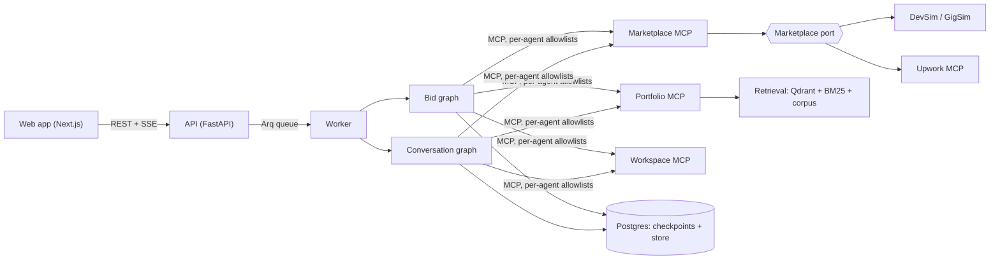

# Architecture

GigBid is two durable LangGraph graphs driven by a background worker, reaching the world only
through MCP tools, with a web app where a human approves every action.

The full graphs, rendered from the compiled code: [GRAPHS.md](GRAPHS.md).

## Request flow

1. A saved search fires on its schedule (or the user clicks "Check for new jobs"). The worker asks
   the Marketplace server for jobs and starts **one bid thread per job**.
2. The bid graph analyses the job, decides, prices, writes and checks, then **interrupts** for
   approval. The API reads the pending approval from the checkpoint, never from memory, so a page
   refresh or an API restart cannot lose it.
3. The user approves, edits or rejects in the proposal studio. The API queues a resume; the worker
   continues the same thread from its checkpoint and submits exactly once (the idempotency key is
   derived from the thread, the job and the draft version).
4. Marketplace events (viewed, replied, hired) update the pipeline board. A client reply starts
   **one conversation thread per conversation**, which drafts a reply and interrupts again.

## The bid graph: why each agent exists

| Node | Role | Why it is a separate step | Model tier |
|---|---|---|---|
| Scout | Loads the job, drops duplicates of recent jobs | Cheap filter before any model runs | none |
| Job Analyst | Extracts requirements, deliverables, screening questions into a `JobSpec` | Every later step needs the same structured reading of the post | small |
| Risk Assessor | Scam, free-work, off-platform, injection and client-quality signals into a `RiskReport` | Deterministic patterns plus the client's history; must run even if fit is perfect | small |
| Fit Matcher | Retrieves evidence per requirement into a `FitReport` | Retrieval quality is the whole basis of a truthful proposal | small |
| (the three above run in parallel with `Send`, then reconcile) | | | |
| Decision | Skip, watch or bid, from fit, risk and thresholds in config | One auditable rule instead of a judgement buried in a prompt; skipping early is the main cost saving | none |
| Pricing Strategist | A `PriceQuote` from market data, budget, floor and Connects cost | Price must be explainable (shown as a rationale at approval) | none |
| Proposal Writer | A `ProposalDraft` citing evidence ids for every claim | The only creative step, on the strongest model | strong |
| Claim verification | Splits the draft into claims and checks each against evidence | Required for everyone (B3); removes or rewrites unsupported claims before the Critic sees them | small |
| Critic | A `Critique`; may send the draft back at most twice | A second reader catches generic or weak drafts the Writer cannot see | strong |
| Compliance Guard | A `ComplianceVerdict` from a deterministic scanner plus a model review of the policy pack | The last gate before a human; can block with a reason shown in the UI | small |
| Approval | `interrupt()` with the full payload | Nothing is sent without a person | — |
| Submit / Send on platform | Creates and submits the proposal; on Upwork, a second approval confirms it | The only nodes that hold write tools | none |
| Learn | Records edits and outcomes for the memory promotion rules | Memory changes only through explicit rules | none |

The conversation graph is load, classify intent (question, negotiation, interview request, scam
signal), find free slots when asked, draft a reply, Compliance, approval, send, learn. The Client
Liaison runs on the strong model; intent and Compliance on the small one.

Every node's model is set in `agent/config.yaml`, never in code, and each node is wrapped with a
timeout, bounded retries and a fallback model for the cheap nodes. A thread that exceeds its step or
token budget moves to **needs attention**; one that cannot complete moves to **dead letter**. Both
are shown in the UI.

## State, execution trace and long-term memory are kept apart

- **State** (`agent/state.py`): what this job or conversation needs now — the job, analyses,
  evidence, decision, price, drafts, critiques, approvals and outcomes. Typed, with reducers where
  the parallel branches write. Stored by the Postgres checkpointer, one thread per job or
  conversation.
- **Execution trace**: every model call and tool call with its arguments and result, kept for
  audit and debugging, never read back by the agents. It lives in LangSmith (masked before sending),
  in the Marketplace server's append-only audit log, and in per-node token and cost records. One
  trace id runs from the browser request through the API, the graph, the MCP servers and the audit
  log, and survives a resume.
- **Long-term memory** (`agent/memory/store.py`, a LangGraph Postgres store): only promoted
  knowledge, written by explicit rules and visible and deletable in Settings.
  - **Style memory**: an edit becomes a rule only when the same edit appears in several separate
    drafts and is made consistently where it could apply (`memory.style_min_edits`,
    `memory.style_min_consistency`).
  - **Outcome memory**: what won or got replies per job category, promoted only after enough
    proposals with a high enough reply rate (`memory.outcome_min_samples`,
    `memory.outcome_min_reply_rate`).
  - Raw tool output never goes into memory.

## Structured hand-offs

Agents exchange Pydantic objects (`agent/handoffs.py`): `JobSpec`, `RiskReport`, `FitReport`,
`BidDecision`, `PriceQuote`, `ProposalDraft`, `Critique`, `ComplianceVerdict`. Free text is never
passed to a later step that decides on it.

## The marketplace port

`agent/marketplace_port.py` is the single interface to a marketplace, with two adapters chosen by
`marketplace.mode`:

- **GigSim/DevSim** (`mcp_servers/marketplace/adapters/gigsim.py`): REST with a per-user rate
  limiter, timeouts, retries and error mapping.
- **Live Upwork** (`adapters/upwork_live.py`): an MCP client of Upwork's official server with each
  user's OAuth token. Submitting only prepares a preview; a second, separate approval confirms it.

Agents never call either adapter. Only the Marketplace MCP server does, so a graph cannot tell
which marketplace is behind it.

## The MCP surface

| Server | Tools | Who may call them |
|---|---|---|
| Portfolio (read-only) | `search_evidence`, `get_case_study`, `list_skills`; resources `portfolio://case/{id}`, `portfolio://proposal/{id}`; two prompts | Fit Matcher, Writer, Critic |
| Marketplace | Reads: jobs, client history, Connects, price stats, proposals, conversations, messages, events. Writes: `create_proposal_draft`, `submit_proposal`, `confirm_proposal`, `send_message` | Reads by the agents that need them; **writes only by the submission step** |
| Workspace | `free_slots`, `create_interview_hold`, `create_email_draft` | Client Liaison (read), submission step (writes) |
| GitHub (third party, read-only) | `get_me`, `search_repositories`, `get_file_contents` | Portfolio ingestion only |
| Upwork (third party) | Seven of its tools, behind the port | The live adapter only |

Each agent's tools are an allowlist in `agent/config.yaml`; a test fails if any agent other than
the submission step can spend Connects or send. Every write has an idempotency key and a `dry_run`
preview; every Marketplace call is audited. Details: [TOOLS.md](TOOLS.md).

## Stores

| Store | Holds |
|---|---|
| Postgres | Users, sessions, encrypted OAuth tokens, runs, pipeline, saved searches; LangGraph checkpoints; the long-term memory store |
| Redis | The work queue, live progress events, the degraded-mode flag |
| Qdrant | Evidence vectors, per tenant |
| SQLite corpus | Evidence text and metadata, and the BM25 index's source |
| Marketplace server SQLite | Idempotent write results and the audit log |
| Workspace server SQLite | Calendar holds and email drafts |

## Trust boundaries

- **Untrusted input**: job posts, client messages and repository text. They are wrapped in tags
  they cannot close, scanned for planted instructions, and never followed.
- **Outgoing text**: every proposal, screening answer and reply passes the same deterministic
  scanner (contact details, off-platform payment, guarantees, credentials, plus any rule added in
  config) and the Compliance Guard.
- **Tenancy**: every query and every MCP call carries the user's identity; a signed bearer names
  the user to each server.
- **Secrets**: only from environment variables; OAuth tokens encrypted at rest; personal data
  masked in logs and traces.

## Failure handling

Per-node timeouts and bounded retries; a fallback model for cheap nodes; marketplace rate limits
and 5xx errors retried with backoff; a marketplace outage puts the UI into degraded mode and queues
the work until the server is back. A crash leaves the thread at its last checkpoint, and the next
run resumes it; approving after a restart submits exactly once.
